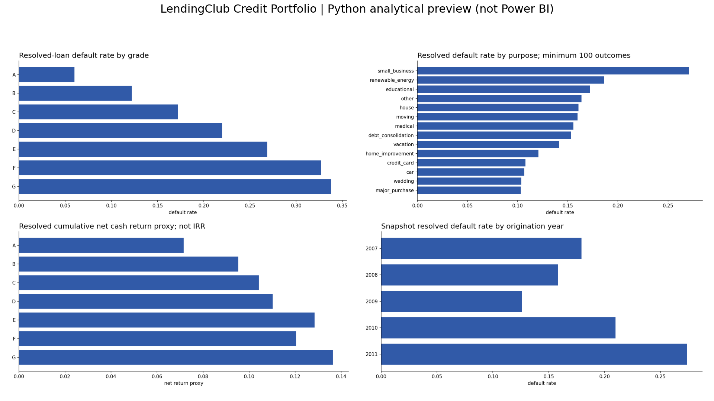

# LendingClub Credit Portfolio

**Owner:** Satya Ranjan Nayak

**Status:** Source analysis completed; Power BI Desktop build remains manual.

## Business Problem

Which accepted-loan grades and borrower segments balance observed credit losses with cumulative cash returns?



## Dataset

https://www.kaggle.com/datasets/wordsforthewise/lending-club

Selected release: historical accepted loans, 2007-2011, 39,717 records, from https://github.com/rbhatia46/LendingClub-Loan-Analysis/blob/master/loan.csv . Source Git blob: 817ea644003cf316116c4c8bcb54d1c760fa0a0b. This is an older release, not the 2018Q4 full file. FICO fields absent. Download this source CSV into `01_Raw_Data/` before rerunning the pipeline. Raw source files are excluded from Git.

## Tools Used

Python (pandas, NumPy, SciPy, Matplotlib), SQLite SQL, Excel, and a Power BI reproduction package. No ML model. No .pbix is claimed.

## Dataset Architecture

See [relationship map](08_Documentation/data_model.md), [data dictionary](08_Documentation/data_dictionary.csv) and [metric definitions](08_Documentation/metric_definitions.md).

## Data Cleaning

Exact duplicate records removed in derived data; conflicting entity keys fail validation. String values trimmed; dates parsed explicitly; invalid elapsed durations excluded from relevant KPI averages. Unknown values stay NULL. Raw files stay unchanged. See data_quality_summary.csv and source_manifest.json after a successful run.

## Business Questions

The four dashboard pages map each visual to a business question in dashboard_documentation.md. SQL answers channel/segment or operational performance questions with explicit denominator choices.

## SQL Analysis

Four scripts cover quality controls, date coverage, grouped business outcomes, and advanced CTE/window analyses. Query results are saved separately in 03_SQL/results. SQLite is the supported dialect; no server setup required. Schema is generated from observed data types, with logical keys validated by Python and SQL controls.

## Python Analysis

Executed cleaning and analysis notebooks accompany this LendingClub project. Descriptive statistics, segmentation, correlation or exploratory group tests are used where meaningful.

## Excel Analysis

The workbook imports manageable complete SQL result tables and adds formula-based comparison metrics. Detailed row-level records remain in cleaned CSVs. Native slicers and PivotTables are not claimed. See 05_Excel/README.md for workbook scope and refresh procedure.

## Dashboard

Four-page Power BI specification, DAX library, typed CSV model, relationship map, theme and Power Query loader are supplied. Python preview images and an offline HTML report visualize calculated outputs but are not Power BI screenshots.

## Key Insights

- 39,717 loans in the 2007-2011 release funded USD 434,810,325.
- 38,577 resolved loans had 5,627 charged-off outcomes (14.59%).
- 1,140 current loans (2.87%) were excluded from resolved-outcome default and return rates.
- Grade G had the highest observed resolved-loan net cash return proxy (13.63%); this is cumulative and not annualized.
- Resolved net cash return proxy was 9.92% before servicing fees, tax and time value.
- Origination FICO is absent in this release. FICO analysis and average FICO are explicitly unavailable.

## Recommendations

- Use the grade risk-return table to design diversification limits, then calculate dated cash-flow IRR and fees before making allocation decisions.
- Investigate high-default purpose and DTI segments only after controlling for grade, term and vintage.
- Compare vintages within matched loan terms and maturity windows; snapshot outcomes alone cannot establish underwriting improvement.
- Add a release containing origination FICO and loan payment schedules to complete credit-score and annualized return analysis.

## Limitations

- Selected older accepted-loan release covers 2007-2011, not the full 2018Q4 release. Outcomes are a historical snapshot, not current borrower status.
- Origination FICO fields are absent. FICO bands and average FICO are unavailable, not imputed.
- Current loans are unresolved. Default and return denominators include only Fully Paid and Charged Off/Default.
- Net cash return proxy is cumulative and funding-weighted, not annualized IRR or a volatility-adjusted ratio. Servicing fees, tax and dated cash-flow timing are unavailable.
- total_pymnt includes recoveries. Adding recoveries again would double-count cash. Collection recovery fees are subtracted.
- Grade, term and maturity differences confound vintage comparisons. No causal underwriting deterioration or investment recommendation is claimed.

## Repository Structure

```
01_Raw_Data/  source acquisition instructions (raw CSVs excluded from Git)
02_Cleaned_Data/  dimensional and fact CSVs
03_SQL/  schema, analysis scripts and query outputs (database regenerated locally)
04_Python/  standalone pipeline and two notebooks
05_Excel/  workbook and its data export
06_PowerBI/  DAX, M, theme, relationships and visual specifications
07_Images/  real Python chart previews
08_Documentation/  definitions, quality report, validations and recommendations
```

## How to Reproduce the Analysis

```bash
python -m pip install -r requirements.txt
python 04_Python/pipeline.py
```

Run notebooks from 04_Python or project root after source acquisition. All raw source files must be present. Pipeline exports cleaned data, runs every named SQL query and validates control totals. Regenerate the Excel workbook using the included artifact-tool builder in the ChatGPT runtime, or import the exported result CSVs into Excel using Data > From Text/CSV. Power BI Desktop instructions are in 06_PowerBI/dashboard_documentation.md.
